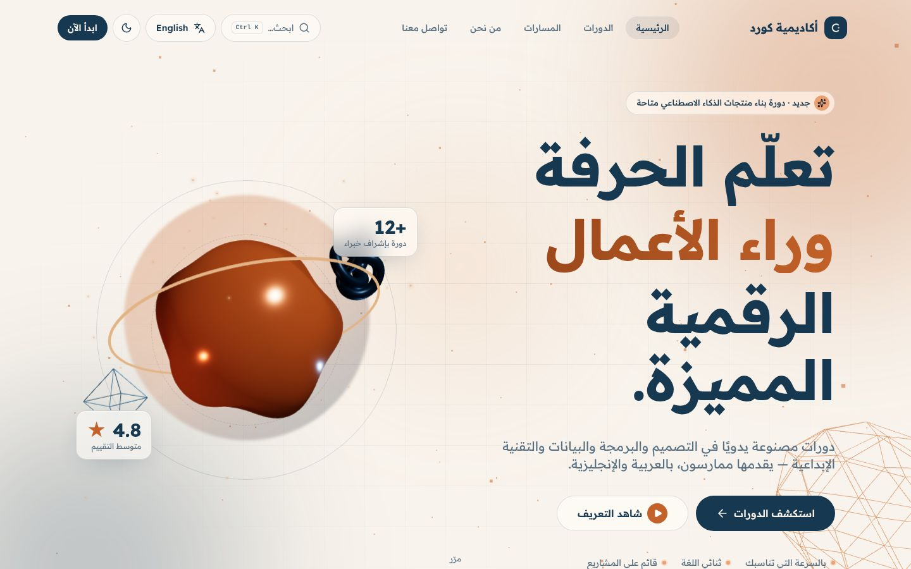
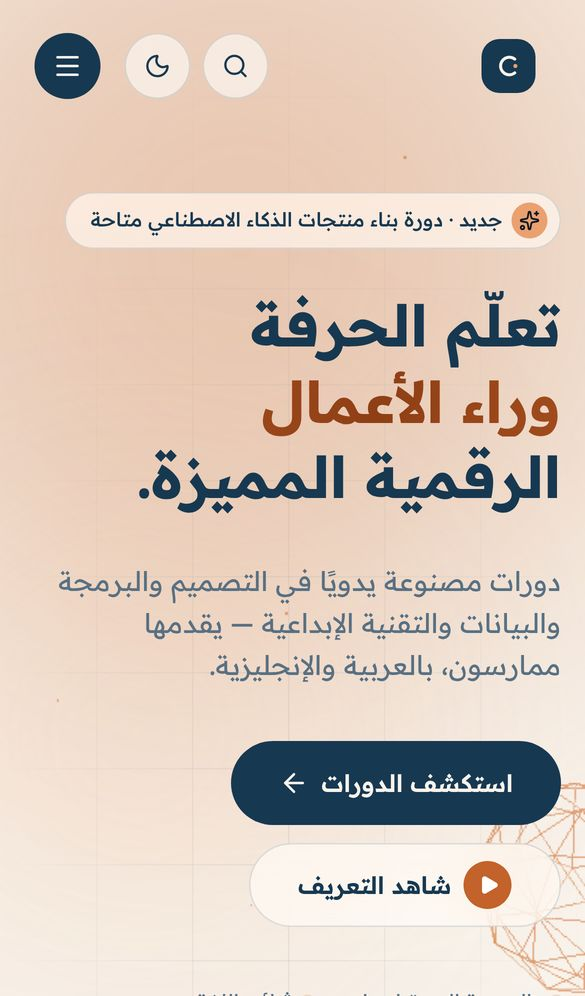
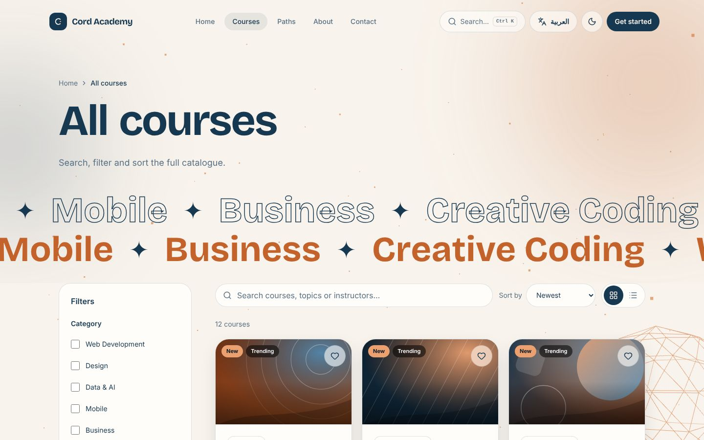

<div align="center">

# Cord Academy

### A bilingual (AR / EN) online-learning website with 3D visuals

The front end of a training academy built with Next.js 16. It has a course catalogue with filters and search, course pages, a lesson video player with saved progress, a student dashboard and React Three Fiber scenes. Arabic (RTL) is the default language.

[](https://nextjs.org)
[](https://react.dev)
[](https://www.typescriptlang.org)
[](https://tailwindcss.com)
[](https://threejs.org)
[](https://r3f.docs.pmnd.rs)
[](https://gsap.com)
[](https://motion.dev)
[](https://lenis.darkroom.engineering)
<br>
[](https://cord-academy.vercel.app)

**[Live demo](https://cord-academy.vercel.app)** ·
**[English version](https://cord-academy.vercel.app/en)** ·
**[Portfolio](https://new-portfolio-ashy-xi.vercel.app/)** ·
**[LinkedIn](https://www.linkedin.com/in/eslamraafat-dev/)** ·
**[Email](mailto:eslamraafat736@gmail.com)**

<br>



</div>

<table>
  <tr>
    <td width="33%"></td>
    <td width="67%"></td>
  </tr>
  <tr>
    <td align="center"><sub>Mobile (iPhone 13), Arabic RTL</sub></td>
    <td align="center"><sub>Course catalogue in English (<code>/en/courses</code>)</sub></td>
  </tr>
</table>

---

## Contents

- [Overview](#overview)
- [Features](#features)
- [Tech stack](#tech-stack)
- [Pages](#pages)
- [Project structure](#project-structure)
- [Getting started](#getting-started)
- [Known limitations](#known-limitations)
- [Deployment](#deployment)
- [Author](#author)

## Overview

Cord Academy is a **personal project**: a complete front end for an online training academy, ready to connect to a real backend.

It is a **demo**, and the site says so. The courses, instructors, reviews and testimonials are sample content. The lesson videos are public sample clips. Sign-in, registration, contact, newsletter and enrolment go through stub functions in [`lib/api.ts`](lib/api.ts), which return `not-connected`, so the UI tells the visitor the action is demo-only. Theme, language, wishlist and lesson progress are saved in the browser.

What it shows:

- **Next.js 16** routing by locale: `app/[lang]`, plus `proxy.ts` to detect the language,
- a UI fully localised in Arabic and English (RTL and LTR) from typed dictionaries,
- **React Three Fiber** scenes next to GSAP, Framer Motion and Lenis,
- filters and search whose state lives in the URL,
- SEO metadata, `hreflang` alternates, JSON-LD and a generated sitemap.

## Features

### Courses

- A **catalogue of 12 courses**, each made of modules and lessons.
- **Course explorer:**
  - text search,
  - filters for category, level and price,
  - sorting by newest, popular or rating,
  - paginated "load more".
  - Filter state is kept in the URL query string, so a filtered view can be shared.
- **Course pages** list the curriculum, instructor and reviews, plus wishlist and share buttons. Sharing uses the Web Share API when the browser supports it.
- **Lesson player** (`/courses/[slug]/watch`) that accepts YouTube, Vimeo or direct `.mp4` links (parsed in `lib/video.ts`). Lesson progress is saved in the browser.
- Learning paths, a categories explorer and "continue learning" sections on the home page.

### Student area (demo)

- A **dashboard** with an overview (counts of courses in progress and completed lessons), my courses, wishlist and settings, all built from data saved in the browser.
- **Login, register and forgot-password** forms with client-side validation. They are ready to be wired to an API.

### Bilingual and accessible

- **Arabic (default) and English.** `proxy.ts` redirects `/` to `/ar` or `/en` based on the saved `lang` cookie, then the browser's `Accept-Language`.
- Each locale is rendered with the right `lang` and `dir`, and the fonts suit each language (Readex Pro for Arabic; Inter and Bricolage Grotesque for Latin).
- **Light/dark theme**, applied before first paint by an inline script.
- **Command palette** (`Ctrl/⌘ + K`) that you can use with the keyboard.
- Breadcrumbs, toasts, an error boundary, loading states and a localised 404.

### Motion and 3D

- A React Three Fiber **hero scene** and a full-page **scroll scene**, both loaded on the client only with `next/dynamic`.
- GSAP scroll effects, Framer Motion reveals, animated counters, magnetic buttons and a custom cursor.
- Lenis smooth scrolling.

### SEO

- `generateMetadata` per locale with canonical URLs and `ar` / `en` / `x-default` alternates.
- JSON-LD: `Course` (with `AggregateRating`) on course pages and `FAQPage` on the FAQ page.
- `sitemap.ts` (with language alternates) and `robots.ts`.
- `lib/analytics.ts` pushes events (video open, wishlist, search, share…) to `window.dataLayer` when it exists.

## Tech stack

| Layer | Tools |
| --- | --- |
| Framework | Next.js 16.4 (App Router, Cache Components, `proxy.ts`, Turbopack) |
| UI library | React 19.3 |
| Language | TypeScript 5 |
| Styling | Tailwind CSS 4, `clsx` + `tailwind-merge` |
| 3D | Three.js r186, @react-three/fiber 9.8, @react-three/drei 10.7 |
| Animation | GSAP 3.15, Framer Motion 14, Lenis 1.3 |
| Icons | lucide-react |
| Hosting | Vercel |

## Pages

All routes are prefixed with the locale: `/ar/...` or `/en/...`.

| Route | Page |
| --- | --- |
| `/` | Home: 3D hero, featured and trending courses, categories, continue learning, learning paths, instructors, stats, testimonials, FAQ |
| `/courses` | Catalogue with search, filters and sorting |
| `/courses/[slug]` | Course details |
| `/courses/[slug]/watch` | Lesson player |
| `/dashboard` · `/courses` · `/wishlist` · `/settings` | Student dashboard (stored in the browser) |
| `/login` · `/register` · `/forgot-password` | Auth forms (demo) |
| `/about` · `/contact` · `/faq` · `/privacy` · `/terms` | Static pages |

## Project structure

```text
.
├── proxy.ts                 # locale redirect: cookie → Accept-Language → /ar
├── app/
│   ├── [lang]/              # every page, localised (layout sets lang/dir, metadata)
│   ├── sitemap.ts
│   └── robots.ts
├── components/
│   ├── animations/          # HeroScene, ScrollScene (R3F), SmoothScroll, cursor, reveals
│   ├── courses/             # explorer, cards, course detail parts, actions
│   ├── video/               # player, modal, watch view
│   ├── dashboard/  forms/  layout/  sections/  providers/  ui/
├── data/                    # courses, instructors, testimonials, FAQs, demo video links
├── lib/
│   ├── i18n/                # ar.ts, en.ts dictionaries + formatting
│   ├── api.ts               # backend stubs (login, register, contact, enrol…)
│   ├── store.ts             # localStorage store via useSyncExternalStore
│   ├── video.ts             # YouTube / Vimeo / mp4 URL parser
│   └── site.ts  analytics.ts  gsap.ts  lenis.ts
├── hooks/  types/
```

## Getting started

**Requirements:** Node.js 20.9 or newer (required by Next.js 16) and npm.

```bash
git clone https://github.com/Eslamraafat1/Cord-academy.git
cd Cord-academy
npm install
npm run dev        # http://localhost:3000 → redirects to /ar
```

| Command | What it does |
| --- | --- |
| `npm run dev` | Start the dev server (Turbopack) |
| `npm run build` | Production build |
| `npm run start` | Serve the production build |
| `npm run lint` | Run ESLint |

Optional environment variables (see [`.env.example`](.env.example)):

| Variable | Used for | When unset |
| --- | --- | --- |
| `NEXT_PUBLIC_SITE_URL` | Canonical/hreflang links, JSON-LD, `sitemap.xml`, `robots.txt` | Falls back to Vercel's `VERCEL_PROJECT_PRODUCTION_URL`, then `https://cord-academy.vercel.app` (never localhost) |
| `NEXT_PUBLIC_CONTACT_EMAIL` | The email shown on `/contact` | The page links to the contact form instead of showing an address |

To connect a backend, replace the stub bodies in `lib/api.ts`.

## Known limitations

- **No backend yet.** Sign-in, registration, the contact form, the newsletter and enrolment call stubs in `lib/api.ts` and tell the visitor the action is demo-only.
- **No public contact email.** None is configured, so `/contact` points to the form rather than showing a placeholder address; set `NEXT_PUBLIC_CONTACT_EMAIL` to show a real one.
- **Footer social icons** link to the platforms' home pages until real profile URLs are added in `components/layout/Footer.tsx`.
- **Sample content.** Courses, instructors, reviews and testimonials are demo data.

## Deployment

Deployed on **Vercel**: [cord-academy.vercel.app](https://cord-academy.vercel.app).

## Author

**Eslam Raafat** — Front-End Developer (React · Next.js · TypeScript)

- **Portfolio:** [new-portfolio-ashy-xi.vercel.app](https://new-portfolio-ashy-xi.vercel.app/)
- **LinkedIn:** [linkedin.com/in/eslamraafat-dev](https://www.linkedin.com/in/eslamraafat-dev/)
- **GitHub:** [@Eslamraafat1](https://github.com/Eslamraafat1)
- **Email:** [eslamraafat736@gmail.com](mailto:eslamraafat736@gmail.com)
